# ERP entity relationships

Phase 0 uses Django User, Group, Permission and Session. The workspace permission uses an unmanaged content type. Redis stores the expiring IP and username login counters. Phase 1 implements master data, physical stock and warehouse carrying value, stocktakes, alerts, and audit events. Phase 2 implements the procurement documents and approval workflow. Payables and later modules remain planned.

```mermaid
erDiagram
    USER }o--o{ GROUP : belongs_to
    GROUP }o--o{ PERMISSION : grants
    USER ||--o{ AUDIT_LOG : acts
    USER ||--o| TELEGRAM_LINK : links
    ITEM_CATEGORY ||--o{ ITEM : classifies
    UNIT_OF_MEASURE ||--o{ ITEM : base_unit
    UNIT_OF_MEASURE ||--o{ UOM_CONVERSION : alternate_unit
    ITEM ||--o{ UOM_CONVERSION : converts
    SUPPLIER ||--o{ SUPPLIER_CONTRACT : signs
    SUPPLIER ||--o{ SUPPLIER_ITEM_PRICE : quotes
    ITEM ||--o{ SUPPLIER_ITEM_PRICE : priced
    WAREHOUSE ||--o{ LOCATION : contains
    ITEM ||--o{ BATCH : tracks
    SUPPLIER |o--o{ BATCH : provides
    GOODS_RECEIPT_LINE |o--|| BATCH : introduces
    BATCH ||--o{ STOCK_MOVEMENT : moves
    LOCATION ||--o{ STOCK_MOVEMENT : affects
    ITEM ||--o{ WAREHOUSE_COST : valued
    WAREHOUSE ||--o{ WAREHOUSE_COST : holds_value
    STOCK_OPERATION ||--|{ STOCK_MOVEMENT : posts
    STOCK_OPERATION |o--o| STOCK_OPERATION : reverses
    USER ||--o{ STOCK_OPERATION : posts
    LOCATION ||--o{ STOCKTAKE : counts_at
    USER ||--o{ STOCKTAKE : counts
    BATCH ||--o{ STOCK_BALANCE : totals
    LOCATION ||--o{ STOCK_BALANCE : holds
    STOCKTAKE ||--|{ STOCKTAKE_LINE : counts
    BATCH ||--o{ STOCKTAKE_LINE : counted
    STOCKTAKE |o--o| STOCK_OPERATION : posts
    ITEM ||--o{ NOTIFICATION : monitors
    BATCH |o--o{ NOTIFICATION : monitors
    USER ||--o{ PURCHASE_REQUEST : requests
    PURCHASE_REQUEST ||--|{ PURCHASE_REQUEST_LINE : contains
    ITEM ||--o{ PURCHASE_REQUEST_LINE : needed
    ITEM_CATEGORY ||--o{ APPROVAL_RULE : scopes
    PURCHASE_REQUEST |o--o| APPROVAL_CASE : requires
    PURCHASE_ORDER_VERSION |o--o| APPROVAL_CASE : requires
    APPROVAL_CASE ||--|{ APPROVAL_STEP : contains
    USER ||--o{ APPROVAL_DELEGATION : delegates
    APPROVAL_RULE ||--o{ APPROVAL_STEP : determines
    USER |o--o{ APPROVAL_STEP : decides
    PURCHASE_REQUEST ||--o{ RFQ : sources
    RFQ ||--o{ QUOTE : receives
    SUPPLIER ||--o{ QUOTE : submits
    RFQ ||--|{ RFQ_SUPPLIER : invites
    QUOTE ||--|{ QUOTE_LINE : contains
    PURCHASE_REQUEST_LINE ||--o{ QUOTE_LINE : prices
    SUPPLIER ||--o{ PURCHASE_ORDER : receives
    PURCHASE_ORDER ||--|{ PURCHASE_ORDER_VERSION : versions
    PURCHASE_ORDER_VERSION ||--|{ PURCHASE_ORDER_LINE : contains
    ITEM ||--o{ PURCHASE_ORDER_LINE : ordered
    PURCHASE_ORDER ||--o{ GOODS_RECEIPT : fulfilled
    PURCHASE_ORDER_VERSION ||--o{ GOODS_RECEIPT : governs
    GOODS_RECEIPT ||--|{ GOODS_RECEIPT_LINE : contains
    GOODS_RECEIPT_LINE ||--o{ SUPPLIER_RETURN : returns
    ATTACHMENT ||--o{ SUPPLIER_RETURN : evidences
    GOODS_RECEIPT_LINE ||--|| STOCK_OPERATION : posts
    PURCHASE_ORDER_LINE ||--o{ GOODS_RECEIPT_LINE : fulfills
    SUPPLIER ||--o{ SUPPLIER_INVOICE : bills
    SUPPLIER_INVOICE ||--|{ SUPPLIER_INVOICE_LINE : contains
    GOODS_RECEIPT_LINE ||--o{ SUPPLIER_INVOICE_LINE : matches
    SUPPLIER ||--o{ PAYMENT : paid
    PAYMENT ||--o{ PAYMENT_ALLOCATION : allocates
    SUPPLIER_INVOICE ||--o{ PAYMENT_ALLOCATION : settles
    SUPPLIER ||--o{ CREDIT_NOTE : credits
    SUPPLIER_INVOICE |o--o{ CREDIT_NOTE : adjusts
    PURCHASE_REQUEST |o--o{ ATTACHMENT : documents
    PURCHASE_ORDER |o--o{ ATTACHMENT : documents
    GOODS_RECEIPT |o--o{ ATTACHMENT : documents
    SUPPLIER_INVOICE |o--o{ ATTACHMENT : documents
    SUPPLIER_CONTRACT |o--o{ ATTACHMENT : documents
    ITEM ||--o{ RECIPE : produced_by
    RECIPE ||--|{ RECIPE_LINE : consumes
    ITEM ||--o{ RECIPE_LINE : ingredient
    RECIPE ||--o{ PRODUCTION_PLAN : schedules
```

- Use indexed, protected business foreign keys and unique business keys.
- Each stock balance has a unique batch and location pair with a nonnegative quantity. Reconcile against signed immutable movements. Each stock operation and movement has a unique idempotency key. WarehouseCost aggregates quantity and five-place carrying value by item and warehouse. Reversals link the original operation and record the source movement in the reference.
- Version orders by unique order and version number. Receipts reference the exact line version. Post corrections through reversing records.
- Store original currency, rate, source and effective date on financial documents. Round money to 2 places and quantities to 3 with Decimal ROUND_HALF_UP. Keep conversion factors and rates at higher precision.
- Store instants in UTC. Interpret business dates in Asia/Tashkent.
